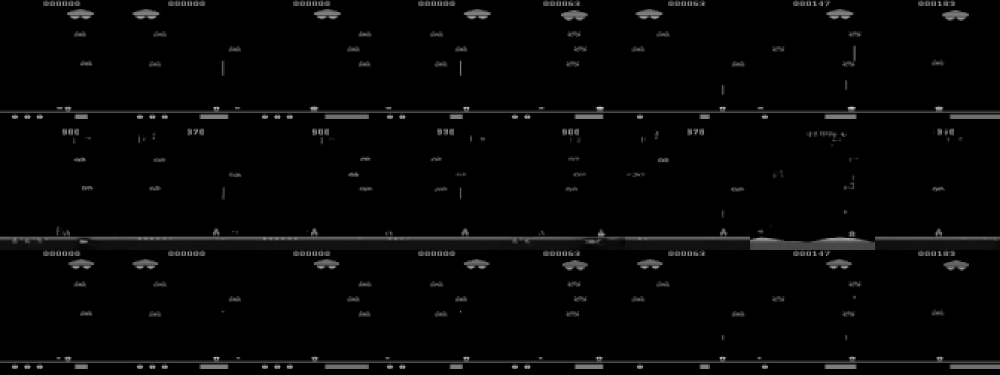
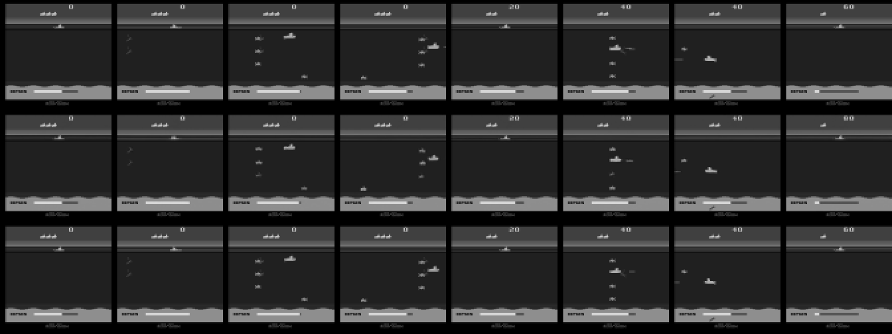

# JOWA-40M and JOWA-150M on an Apple-silicon Mac: results

Experiment `2026-11-24-jowa-mac-smoke`, run on 2026-11-24 at research `3da0314` (code id `inputs.src` `e8dd044`) (`inputs` are as of HEAD; the 32 cells ran on the earlier code tree, which differs only by `src/diagnose.py` and the `--diagnose` branch of `run.sh`, and the diagnostics ran on the current one). Plan:
[plan.md](plan.md). Machine-readable results: [results.json](results.json).

## Verdicts

| Claim | Verdict | Evidence |
|---|---|---|
| cheng2025jointly#C16 | inconclusive | exploratory run, capped at inconclusive (the observed values alone would read as supports): models_loaded 2/2, nonfinite_count 0, episodes_completed 32/32; the weights are not in the GitHub repo (Git LFS disabled) and come from the README's Google Drive folder |

## Metrics

| Metric | Value | Unit | n | CI |
|---|---|---|---|---|
| models_loaded | 2 | 1 | 2 | |
| nonfinite_count | 0 | 1 | 32 | |
| episodes_completed | 32 | 1 | 32 | |
| episodes_planned | 32 | 1 | 32 | |
| illegal_action_count | 0 | 1 | 32 | |
| params_40m | 19109681 | 1 | 1 | |
| load_s_40m | 0.02713 | s | 1 | |
| ms_per_step_40m_mps_noplan | 29.16 | ms | 4 | |
| ms_per_step_40m_mps_plan | 954.4 | ms | 4 | |
| ms_per_step_40m_cpu_noplan | 31.27 | ms | 4 | |
| ms_per_step_40m_cpu_plan | 863.4 | ms | 4 | |
| params_150m | 127778185 | 1 | 1 | |
| load_s_150m | 0.0909 | s | 1 | |
| ms_per_step_150m_mps_noplan | 54.76 | ms | 4 | |
| ms_per_step_150m_mps_plan | 1984 | ms | 4 | |
| ms_per_step_150m_cpu_noplan | 124.4 | ms | 4 | |
| ms_per_step_150m_cpu_plan | 3155 | ms | 4 | |
| tokenizer_params | 18763649 | 1 | 1 | |
| tokens_per_frame | 36 | 1 | 1 | |
| tokenizer_vocab | 2048 | 1 | 1 | |
| tokenizer_recon_mse_assault | 0.008033 | 1 | 1 | |
| frame_variance_assault | 0.00846 | 1 | 1 | |
| tokenizer_recon_mse_seaquest | 0.0002655 | 1 | 1 | |
| frame_variance_seaquest | 0.02891 | 1 | 1 | |
| mean_clipped_return_capped | 3.719 | 1 | 32 | |

Per-cell results (one capped episode each; `ms/step` is the median `agent.act` time, env stepping excluded):

| device | model | game | planning | seed | steps | return | clipped | ms/step | first step ms | distinct actions |
|---|---|---|---|---|---|---|---|---|---|---|
| mps | JOWA_40M | Assault | off (buf 8) | 0 | 300 | 231 | 11 | 28 | 250 | 5 |
| mps | JOWA_40M | Assault | off (buf 8) | 1 | 300 | 210 | 10 | 28 | 23 | 4 |
| mps | JOWA_40M | Assault | beam bw=2 h=2 buf=3 | 0 | 30 | 0 | 0 | 931 | 2180 | 3 |
| mps | JOWA_40M | Assault | beam bw=2 h=2 buf=3 | 1 | 30 | 0 | 0 | 937 | 935 | 4 |
| mps | JOWA_40M | Seaquest | off (buf 8) | 0 | 300 | 0 | 0 | 33 | 27 | 1 |
| mps | JOWA_40M | Seaquest | off (buf 8) | 1 | 300 | 0 | 0 | 28 | 23 | 1 |
| mps | JOWA_40M | Seaquest | beam bw=4 h=2 buf=2 | 0 | 30 | 0 | 0 | 975 | 2779 | 9 |
| mps | JOWA_40M | Seaquest | beam bw=4 h=2 buf=2 | 1 | 30 | 0 | 0 | 975 | 1056 | 12 |
| mps | JOWA_150M | Assault | off (buf 8) | 0 | 300 | 315 | 15 | 55 | 1111 | 5 |
| mps | JOWA_150M | Assault | off (buf 8) | 1 | 300 | 315 | 15 | 55 | 34 | 5 |
| mps | JOWA_150M | Assault | beam bw=2 h=2 buf=4 | 0 | 30 | 84 | 4 | 1712 | 3634 | 6 |
| mps | JOWA_150M | Assault | beam bw=2 h=2 buf=4 | 1 | 30 | 42 | 2 | 1667 | 1697 | 6 |
| mps | JOWA_150M | Seaquest | off (buf 8) | 0 | 300 | 0 | 0 | 55 | 40 | 1 |
| mps | JOWA_150M | Seaquest | off (buf 8) | 1 | 300 | 0 | 0 | 55 | 33 | 1 |
| mps | JOWA_150M | Seaquest | beam bw=4 h=2 buf=6 | 0 | 30 | 0 | 0 | 2316 | 4202 | 11 |
| mps | JOWA_150M | Seaquest | beam bw=4 h=2 buf=6 | 1 | 30 | 0 | 0 | 2242 | 1928 | 6 |
| cpu | JOWA_40M | Assault | off (buf 8) | 0 | 300 | 252 | 12 | 28 | 29 | 6 |
| cpu | JOWA_40M | Assault | off (buf 8) | 1 | 300 | 189 | 9 | 29 | 14 | 6 |
| cpu | JOWA_40M | Assault | beam bw=2 h=2 buf=3 | 0 | 60 | 42 | 2 | 487 | 465 | 5 |
| cpu | JOWA_40M | Assault | beam bw=2 h=2 buf=3 | 1 | 60 | 42 | 2 | 461 | 698 | 5 |
| cpu | JOWA_40M | Seaquest | off (buf 8) | 0 | 300 | 0 | 0 | 32 | 15 | 2 |
| cpu | JOWA_40M | Seaquest | off (buf 8) | 1 | 300 | 40 | 2 | 37 | 17 | 2 |
| cpu | JOWA_40M | Seaquest | beam bw=4 h=2 buf=2 | 0 | 60 | 0 | 0 | 1268 | 1109 | 15 |
| cpu | JOWA_40M | Seaquest | beam bw=4 h=2 buf=2 | 1 | 60 | 0 | 0 | 1237 | 1347 | 14 |
| cpu | JOWA_150M | Assault | off (buf 8) | 0 | 300 | 252 | 12 | 129 | 184 | 5 |
| cpu | JOWA_150M | Assault | off (buf 8) | 1 | 300 | 315 | 15 | 114 | 43 | 5 |
| cpu | JOWA_150M | Assault | beam bw=2 h=2 buf=4 | 0 | 60 | 105 | 5 | 2599 | 2257 | 6 |
| cpu | JOWA_150M | Assault | beam bw=2 h=2 buf=4 | 1 | 60 | 63 | 3 | 2593 | 1976 | 7 |
| cpu | JOWA_150M | Seaquest | off (buf 8) | 0 | 300 | 0 | 0 | 128 | 54 | 2 |
| cpu | JOWA_150M | Seaquest | off (buf 8) | 1 | 300 | 0 | 0 | 127 | 41 | 1 |
| cpu | JOWA_150M | Seaquest | beam bw=4 h=2 buf=6 | 0 | 60 | 0 | 0 | 3641 | 3836 | 13 |
| cpu | JOWA_150M | Seaquest | beam bw=4 h=2 buf=6 | 1 | 60 | 0 | 0 | 3788 | 3068 | 13 |

Timing by game and beam width (mean of the two per-cell medians, one per seed; the pooled `ms_per_step_*` metrics above are means of such medians over both games, which have different beam widths, so read them with this table):

| model | game | planning | step cap (MPS/CPU) | MPS ms/step | CPU ms/step |
|---|---|---|---|---|---|
| JOWA_40M | Assault | off (buf 8) | 300/300 | 28 | 28 |
| JOWA_40M | Assault | beam bw=2 h=2 buf=3 | 30/60 | 934 | 474 |
| JOWA_40M | Seaquest | off (buf 8) | 300/300 | 30 | 34 |
| JOWA_40M | Seaquest | beam bw=4 h=2 buf=2 | 30/60 | 975 | 1253 |
| JOWA_150M | Assault | off (buf 8) | 300/300 | 55 | 121 |
| JOWA_150M | Assault | beam bw=2 h=2 buf=4 | 30/60 | 1689 | 2596 |
| JOWA_150M | Seaquest | off (buf 8) | 300/300 | 55 | 127 |
| JOWA_150M | Seaquest | beam bw=4 h=2 buf=6 | 30/60 | 2279 | 3715 |

Load and tokenizer checks:

- JOWA_40M: 19,109,681 parameters (4 layers, width 512), 0.03 s (warm page cache, includes the tokenizer reload, instantiation excluded) to load, missing keys 0, 4 `attn.mask` buffers skipped (built at init).
- JOWA_150M: 127,778,185 parameters (12 layers, width 768), 0.09 s (warm page cache, includes the tokenizer reload, instantiation excluded) to load, missing keys 0, 12 `attn.mask` buffers skipped (built at init).
- Parameter counts without training-only modules (`run.sh --diagnose`, `diagnostics.json`): JOWA-40M model 17.4M (total 19.1M, minus the unused `head_q_target` copy 1.7M); JOWA-150M model 109.0M (total 127.8M, minus `head_q_target` 18.7M); tokenizer encoder, decoder and codebook 4.0M (total 18.8M, of which 14.7M are the LPIPS-VGG16 slices used only by the training loss). The raw totals are the metrics `params_*` and `tokenizer_params` above.
- Tokenizer (18,763,649 parameters, incl. the LPIPS-VGG weights stored in tokenizer.pt): 36 tokens per frame, vocabulary 2048. Reconstruction of a real frame after 100 random legal actions: Assault: MSE 0.008 vs frame variance 0.0085, 30 distinct tokens; Seaquest: MSE 0.00027 vs frame variance 0.029, 33 distinct tokens.

## Checks

- none (inference and plumbing smoke test with no derivation or custom gradient; the run's own assertions on state-dict keys, action legality and finiteness passed: 0 missing keys, 0 illegal actions, 0 non-finite Q values over all steps; "missing keys 0" and "0 illegal actions" hold by construction, see Notes)
- src/diagnose.py (`run.sh --diagnose`, CPU, about 5 min, added after review): the ALE v5 shim's minimal action meanings for Assault and Seaquest equal upstream's `_LIMITED_ACTION_SET` tables exactly (asserted); tokenizer reconstructions of 8 frames per game from seeded random legal play (below); greedy action histograms with the default and the repo's tuned context length (below); parameter counts. Outputs: [diagnostics.json](diagnostics.json), figures below.

## Deviations from the plan

- The first weights fetch took the whole Drive folder and so also downloaded JOWA-70M (213 MB, deleted); `run.sh` fetches single files.
- Two more runtime patches than the plan listed were needed and are in `src/jowa_patch.py`: the `attn.mask` checkpoint keys (upstream's loader raises KeyError without FlashAttention), and MPS handling (an empty head slice asserts on MPS, and `atoms_support` is a plain tensor that `.to()` does not move, in `smoke.py`). Plus a pygame stub and a LPIPS builder that skips the 0.5 GB VGG download.
- Planning episodes on MPS were capped at 30 agent steps instead of 60 (MPS planning is slower); CPU planning episodes used 60. Step caps are in the per-cell table.
- The CPU cells ran while other experiments used the machine, so CPU timings are noisy (an earlier CPU-only development run of the same code, `--no-write`, gave 40M planning 517 ms/step on Assault and 950 ms on Seaquest, 150M 1.6 s and 2.4 s, against the committed run's pooled means above).
- The plan's Method listed three patches that were not written because they were unnecessary: device selection (the model is built on CPU and moved with `.to()`, and `Agent` takes the device as an argument), a device-generic autocast (upstream's `torch.cuda.amp.autocast` is a disabled no-op without CUDA and `dtype` is set to float32 through the config argument), and guarded CUDA RNG calls (`torch.cuda.manual_seed*` do nothing without CUDA).
- `models_loaded` as implemented: upstream-style loading raises KeyError on any missing key and aborts the whole run, so "missing keys 0" holds by construction and a recorded run cannot show `models_loaded` below the number of sizes. The per-size condition also required every cell of that size to complete; the plan's "every checked output finite" is covered by `nonfinite_count` instead. The criterion's "contradicts" branch (`models_loaded == 0`) is therefore only reachable as a failed run, not as a recorded result.
- CPU threads: `torch.set_num_threads(cpu_count - 2)` is in the code (8 of this Mac's 10 cores) but is not recorded in `results.json`; this is more than the brief's "modest" CPU use and, together with other jobs running, makes CPU timings noisy. The diagnose run used 4 threads (`diagnostics.json`).
- `inputs` in `results.json` was refreshed after review: `src/diagnose.py` was added (new `src/` tree) and `run.sh` got a `--diagnose` branch. `smoke.py`, `jowa_patch.py` and `requirements.txt` are unchanged since the run, so the recorded results come from the same code path. `commits[0].sha` is the rewritten HEAD; the run itself happened at a now-unreachable commit with the same `smoke.py` and `jowa_patch.py`.
- MPS runs first, then CPU (so the GPU slot was released early); this does not change results.
- Not done: MPS bf16 autocast (upstream's autocast is CUDA-only and a no-op here; all runs are float32).

## Figures

-  Rows: original, reconstruction, alternative grayscale. Frames at steps 20, 60, 100, 150, 200, 300, 400, 500 of seeded random legal play. The reconstruction does not reproduce the frame (it draws different score digits and moves objects).
-  Reconstructions are near-exact.

## Reproduce

```sh
experiments/2026-11-24-jowa-mac-smoke/run.sh
```

Expected wall clock about 28 min on this Mac (1673 s recorded, with other jobs running) plus about 2 min for a cold environment and clone; it needs the weights in `~/.cache/jowa` (else about 660 MB from Google Drive) and the MPS GPU slot. `run.sh --diagnose` (CPU, about 5 min) regenerates `diagnostics.json` and the figures. Tolerances from the plan: `models_loaded` within 0, `nonfinite_count` within 0, `episodes_completed` within 0. A rerun reproduces when the verdict is unchanged and each toleranced metric is within its tolerance. Timings and returns are reported, not compared.

## Notes

- Weights are not obtainable from GitHub: `checkpoints/JOWA/*.pt` in the repo are Git LFS pointers and the LFS batch API answers 403 "Git LFS is disabled for this repository". The README's Google Drive folder is the only working source; the sha256 and size of all three files (40M, 150M, tokenizer) equal the oid and size in the repo's LFS pointers (so the Drive files are the files the repo meant to ship). All files are pickles loaded with `torch.load` from that official source.
- Sizes: the nominal "40M" and "150M" do not match the inference-time parameter counts: the model is 17.4M / 109.0M without the unused target Q-head copy (raw `JOWA_*.pt` model totals 19.1M / 127.8M), and the tokenizer is 4.0M without the training-only LPIPS-VGG (raw 18.8M).
- MPS versus CPU depends on the game and beam width (see the per-game table): for 40M planning MPS is slower on Assault (beam width 2) and faster on Seaquest (beam width 4); greedy 150M is 55 ms on MPS against 124 ms on CPU, 40M is 29 against 31 ms. Planning costs about 25x to 35x more per step than greedy acting (pooled means of per-cell medians: 40M CPU 28x, 150M CPU 25x, 150M MPS 36x), against the paper's 10.8 FPS without planning and 1.26 FPS with (an ~9x gap, 150M on other hardware, Python implementations). The MPS planning episodes were capped at 30 steps and the CPU ones at 60.
- Returns of capped episodes (300 steps without planning, 30 to 60 with) are not comparable with the paper's 108k-frame episodes, and no claim about performance is made. Seaquest returns are near zero for most cells in the first few hundred steps.
- What the run does and does not show: "legal actions only" and "0 missing keys" hold by construction: upstream's `Agent` masks the argmax with `action_masks`, upstream's `AtariEnvWrapper.step` asserts on any unmapped action, and `Agent.load` raises on a missing key. They show that no exception occurred, not that the port feeds the model what it was trained on. What was checked: the shim's action sets equal upstream's tables for both games, and no non-finite Q value occurred.
- Port fidelity is untested and two anomalies are unexplained (`diagnostics.json`). (1) Assault: the tokenizer, trained on this game, does not reconstruct the port's frames: reconstruction MSE over frame variance is 1.04 on average over 8 frames (about 1 means no better than the mean frame); the port calls the same `getScreenGrayscale` as upstream, and an RGB-to-gray alternative that differs from it by under 0.6 of 255 gray levels gives 1.09, which is a near-identical input and does not test a different conversion; the figure shows hallucinated score digits and displaced objects. Seaquest reconstructs near-exactly (ratio 0.004). The cause is not established: a preprocessing, ROM or ALE-version mismatch between this port and the training frames is possible, as is a tokenizer that is weak on this game; the run cannot tell whether the model sees what it was trained on in Assault. (An earlier explanation here, sparse bright objects on a dark frame, was not measured and is dropped.) (2) Seaquest greedy play: JOWA-150M picks one action for 300 steps in 3 of 4 runs (UPRIGHT, also with the tuned context length 6) and scores 0, while 40M also concentrates on one or two actions per run (e.g. DOWN 297 of 300, or UPLEFT and DOWNRIGHT about half each) and scores 0 to 60 (histograms below). Whether that is the model, the context handling or the port is unknown; Assault greedy play is varied and scores 189 to 336 in 300 steps.
- Greedy action histograms, 300 steps, CPU (`diagnostics.json`; context 8 is the smoke run's default, "tuned" is the repo's per-game buffer size from `eval/JOWA_*_raw_scores.json`):

| model | game | context | seed | return | action histogram |
|---|---|---|---|---|---|
| JOWA_40M | Assault | 8 | 0 | 252 | LEFT 107, UP 86, RIGHTFIRE 53, RIGHT 47, FIRE 6, NOOP 1 |
| JOWA_40M | Assault | 8 | 1 | 189 | LEFT 157, UP 65, RIGHTFIRE 52, RIGHT 24, FIRE 1, NOOP 1 |
| JOWA_40M | Assault | 3 (tuned) | 0 | 273 | UP 90, RIGHT 87, LEFT 73, RIGHTFIRE 39, NOOP 9, FIRE 2 |
| JOWA_40M | Assault | 3 (tuned) | 1 | 252 | UP 192, RIGHT 49, RIGHTFIRE 32, LEFT 23, LEFTFIRE 3, FIRE 1 |
| JOWA_40M | Seaquest | 8 | 0 | 0 | DOWNRIGHT 153, UPLEFT 147 |
| JOWA_40M | Seaquest | 8 | 1 | 40 | DOWN 297, UPRIGHT 3 |
| JOWA_40M | Seaquest | 2 (tuned) | 0 | 60 | DOWNLEFTFIRE 230, UPLEFT 70 |
| JOWA_40M | Seaquest | 2 (tuned) | 1 | 0 | UPRIGHT 205, UP 95 |
| JOWA_150M | Assault | 8 | 0 | 252 | UP 166, RIGHTFIRE 107, RIGHT 14, LEFT 12, FIRE 1 |
| JOWA_150M | Assault | 8 | 1 | 315 | UP 213, LEFT 56, RIGHT 22, RIGHTFIRE 5, NOOP 4 |
| JOWA_150M | Assault | 4 (tuned) | 0 | 273 | RIGHT 131, FIRE 62, LEFT 53, UP 44, RIGHTFIRE 9, NOOP 1 |
| JOWA_150M | Assault | 4 (tuned) | 1 | 336 | UP 131, RIGHT 86, LEFT 65, NOOP 8, RIGHTFIRE 5, FIRE 5 |
| JOWA_150M | Seaquest | 8 | 0 | 0 | UPRIGHT 162, UPFIRE 138 |
| JOWA_150M | Seaquest | 8 | 1 | 0 | UPRIGHT 300 |
| JOWA_150M | Seaquest | 6 (tuned) | 0 | 0 | UPRIGHT 300 |
| JOWA_150M | Seaquest | 6 (tuned) | 1 | 0 | UPRIGHT 300 |

- Going further: On TheaterPC with CUDA the device patches would be unnecessary (upstream defaults to `cuda:0`; flash-attn is optional) but the gym 0.19/atari-py to ale-py port in `src/jowa_patch.py` is still needed, and upstream's eval scripts assume 8 GPUs and bash+jq, while `run.sh` drives `Agent` in-process. Training needs the DQN-Replay data (about 1 TB per the README) and is out of scope for the Mac.
- Licence: code GPL-3.0 (repo LICENSE); the weights' licence is unstated.

