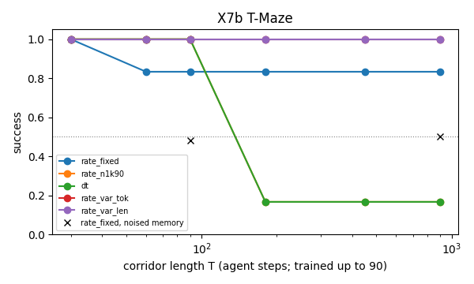
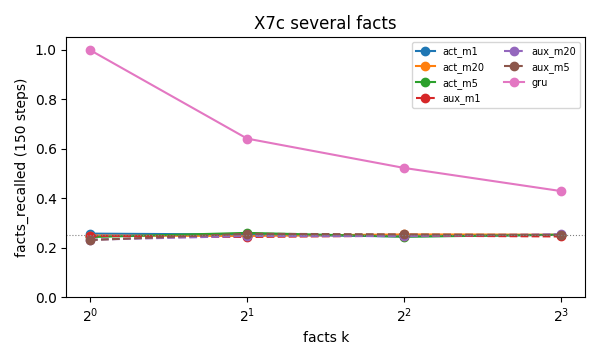
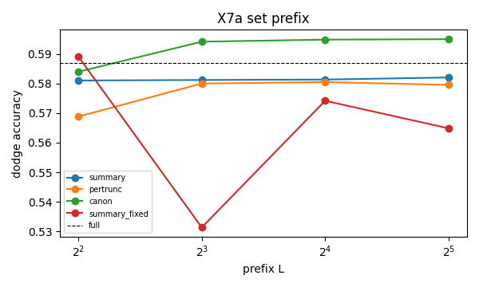

# Memory-token toys for the shmup stack (X7): results

<!-- generated:run begin -->
Experiment `2026-11-27-memory-token-toys`, run on 2026-11-27 at research `bb8b5cf` (code id `inputs.src` `d236fcd`), wall clock 104 min. Plan: [plan.md](plan.md). Machine-readable results: [results.json](results.json).
<!-- generated:run end -->

## Verdicts

<!-- generated:verdicts begin -->
| Claim | Verdict | Evidence |
|---|---|---|
| cherepanov2026recurrent#C1 | inconclusive | rate_fixed_success_in 0.889 (>= 0.95), rate_fixed_success_t900 0.833 (>= 0.7), dt_success_t900 0.167 (<= 0.6); contradicts if success_in < 0.8 or t900 < dt + 0.1 |
| cherepanov2026recurrent#C8 | inconclusive | rate_fixed_success_t90 0.833 (>= 0.9), rate_fixed_noise_success_t90 0.482 (<= 0.65), rate_fixed_noise_junction_t90 1.000 (>= 0.9); contradicts if t90 >= 0.9 and noise >= t90 - 0.1 |
| cherepanov2026recurrent#C12 | supports | rate_fixed_success_t900 0.833 - rate_n1k90_success_t900 0.167 = 0.667 (>= 0.3), rate_n1k90_success_t900 <= 0.55; contradicts if the difference <= 0.1 |
<!-- generated:verdicts end -->

## Metrics

<!-- generated:metrics begin -->
| Metric | Value | Unit | n | CI |
|---|---|---|---|---|
| rate_fixed_success_t30 | 1 | 1 | 600 | [1.000, 1.000] at 0.95 |
| rate_fixed_junction_t30 | 1 | 1 | 600 | [1.000, 1.000] at 0.95 |
| rate_fixed_success_t60 | 0.8333 | 1 | 600 | [0.500, 1.000] at 0.95 |
| rate_fixed_junction_t60 | 1 | 1 | 600 | [1.000, 1.000] at 0.95 |
| rate_fixed_success_t90 | 0.8333 | 1 | 600 | [0.500, 1.000] at 0.95 |
| rate_fixed_junction_t90 | 1 | 1 | 600 | [1.000, 1.000] at 0.95 |
| rate_fixed_success_t180 | 0.8333 | 1 | 600 | [0.500, 1.000] at 0.95 |
| rate_fixed_junction_t180 | 1 | 1 | 600 | [1.000, 1.000] at 0.95 |
| rate_fixed_success_t450 | 0.8333 | 1 | 600 | [0.500, 1.000] at 0.95 |
| rate_fixed_junction_t450 | 1 | 1 | 600 | [1.000, 1.000] at 0.95 |
| rate_fixed_success_t900 | 0.8333 | 1 | 600 | [0.500, 1.000] at 0.95 |
| rate_fixed_junction_t900 | 1 | 1 | 600 | [1.000, 1.000] at 0.95 |
| rate_fixed_noise_success_t90 | 0.4817 | 1 | 600 | [0.445, 0.510] at 0.95 |
| rate_fixed_noise_junction_t90 | 1 | 1 | 600 | [1.000, 1.000] at 0.95 |
| rate_fixed_noise_success_t900 | 0.5017 | 1 | 600 | [0.460, 0.545] at 0.95 |
| rate_fixed_noise_junction_t900 | 1 | 1 | 600 | [1.000, 1.000] at 0.95 |
| rate_fixed_success_in | 0.8889 | 1 | 1800 | [0.667, 1.000] at 0.95 |
| rate_fixed_loss_action | 0.003477 | 1 | 3 |  |
| rate_n1k90_success_t30 | 1 | 1 | 600 | [1.000, 1.000] at 0.95 |
| rate_n1k90_junction_t30 | 1 | 1 | 600 | [1.000, 1.000] at 0.95 |
| rate_n1k90_success_t60 | 1 | 1 | 600 | [1.000, 1.000] at 0.95 |
| rate_n1k90_junction_t60 | 1 | 1 | 600 | [1.000, 1.000] at 0.95 |
| rate_n1k90_success_t90 | 1 | 1 | 600 | [1.000, 1.000] at 0.95 |
| rate_n1k90_junction_t90 | 1 | 1 | 600 | [1.000, 1.000] at 0.95 |
| rate_n1k90_success_t180 | 0.1667 | 1 | 600 | [0.000, 0.500] at 0.95 |
| rate_n1k90_junction_t180 | 0.3333 | 1 | 600 | [0.000, 1.000] at 0.95 |
| rate_n1k90_success_t450 | 0.1667 | 1 | 600 | [0.000, 0.500] at 0.95 |
| rate_n1k90_junction_t450 | 0.3333 | 1 | 600 | [0.000, 1.000] at 0.95 |
| rate_n1k90_success_t900 | 0.1667 | 1 | 600 | [0.000, 0.500] at 0.95 |
| rate_n1k90_junction_t900 | 0.3333 | 1 | 600 | [0.000, 1.000] at 0.95 |
| rate_n1k90_success_in | 1 | 1 | 1800 | [1.000, 1.000] at 0.95 |
| rate_n1k90_loss_action | 2.275e-05 | 1 | 3 |  |
| dt_success_t30 | 1 | 1 | 600 | [1.000, 1.000] at 0.95 |
| dt_junction_t30 | 1 | 1 | 600 | [1.000, 1.000] at 0.95 |
| dt_success_t60 | 1 | 1 | 600 | [1.000, 1.000] at 0.95 |
| dt_junction_t60 | 1 | 1 | 600 | [1.000, 1.000] at 0.95 |
| dt_success_t90 | 1 | 1 | 600 | [1.000, 1.000] at 0.95 |
| dt_junction_t90 | 1 | 1 | 600 | [1.000, 1.000] at 0.95 |
| dt_success_t180 | 0.1667 | 1 | 600 | [0.000, 0.500] at 0.95 |
| dt_junction_t180 | 0.3333 | 1 | 600 | [0.000, 1.000] at 0.95 |
| dt_success_t450 | 0.1667 | 1 | 600 | [0.000, 0.500] at 0.95 |
| dt_junction_t450 | 0.3333 | 1 | 600 | [0.000, 1.000] at 0.95 |
| dt_success_t900 | 0.1667 | 1 | 600 | [0.000, 0.500] at 0.95 |
| dt_junction_t900 | 0.3333 | 1 | 600 | [0.000, 1.000] at 0.95 |
| dt_success_in | 1 | 1 | 1800 | [1.000, 1.000] at 0.95 |
| dt_loss_action | 2.07e-05 | 1 | 3 |  |
| rate_var_tok_success_t30 | 1 | 1 | 600 | [1.000, 1.000] at 0.95 |
| rate_var_tok_junction_t30 | 1 | 1 | 600 | [1.000, 1.000] at 0.95 |
| rate_var_tok_success_t60 | 1 | 1 | 600 | [1.000, 1.000] at 0.95 |
| rate_var_tok_junction_t60 | 1 | 1 | 600 | [1.000, 1.000] at 0.95 |
| rate_var_tok_success_t90 | 1 | 1 | 600 | [1.000, 1.000] at 0.95 |
| rate_var_tok_junction_t90 | 1 | 1 | 600 | [1.000, 1.000] at 0.95 |
| rate_var_tok_success_t180 | 1 | 1 | 600 | [1.000, 1.000] at 0.95 |
| rate_var_tok_junction_t180 | 1 | 1 | 600 | [1.000, 1.000] at 0.95 |
| rate_var_tok_success_t450 | 1 | 1 | 600 | [1.000, 1.000] at 0.95 |
| rate_var_tok_junction_t450 | 1 | 1 | 600 | [1.000, 1.000] at 0.95 |
| rate_var_tok_success_t900 | 1 | 1 | 600 | [1.000, 1.000] at 0.95 |
| rate_var_tok_junction_t900 | 1 | 1 | 600 | [1.000, 1.000] at 0.95 |
| rate_var_tok_success_in | 1 | 1 | 1800 | [1.000, 1.000] at 0.95 |
| rate_var_tok_loss_action | 3.479e-05 | 1 | 3 |  |
| rate_var_len_success_t30 | 1 | 1 | 600 | [1.000, 1.000] at 0.95 |
| rate_var_len_junction_t30 | 1 | 1 | 600 | [1.000, 1.000] at 0.95 |
| rate_var_len_success_t60 | 1 | 1 | 600 | [1.000, 1.000] at 0.95 |
| rate_var_len_junction_t60 | 1 | 1 | 600 | [1.000, 1.000] at 0.95 |
| rate_var_len_success_t90 | 1 | 1 | 600 | [1.000, 1.000] at 0.95 |
| rate_var_len_junction_t90 | 1 | 1 | 600 | [1.000, 1.000] at 0.95 |
| rate_var_len_success_t180 | 1 | 1 | 600 | [1.000, 1.000] at 0.95 |
| rate_var_len_junction_t180 | 1 | 1 | 600 | [1.000, 1.000] at 0.95 |
| rate_var_len_success_t450 | 1 | 1 | 600 | [1.000, 1.000] at 0.95 |
| rate_var_len_junction_t450 | 1 | 1 | 600 | [1.000, 1.000] at 0.95 |
| rate_var_len_success_t900 | 1 | 1 | 600 | [1.000, 1.000] at 0.95 |
| rate_var_len_junction_t900 | 1 | 1 | 600 | [1.000, 1.000] at 0.95 |
| rate_var_len_success_in | 1 | 1 | 1800 | [1.000, 1.000] at 0.95 |
| rate_var_len_loss_action | 2.703e-05 | 1 | 3 |  |
| facts_recalled_act_m1_k1 | 0.2567 | 1 | 1500 | [0.252, 0.264] at 0.95 |
| facts_recalled_act_m1_k2 | 0.253 | 1 | 3000 | [0.236, 0.269] at 0.95 |
| facts_recalled_act_m1_k4 | 0.2453 | 1 | 6000 | [0.241, 0.249] at 0.95 |
| facts_recalled_act_m1_k8 | 0.252 | 1 | 12000 | [0.247, 0.255] at 0.95 |
| facts_recalled_act_m1_k1_l450 | 0.2407 | 1 | 1500 | [0.216, 0.256] at 0.95 |
| facts_recalled_act_m1_k2_l450 | 0.259 | 1 | 3000 | [0.245, 0.279] at 0.95 |
| facts_recalled_act_m1_k4_l450 | 0.2525 | 1 | 6000 | [0.247, 0.262] at 0.95 |
| facts_recalled_act_m1_k8_l450 | 0.2477 | 1 | 12000 | [0.239, 0.259] at 0.95 |
| act_m1_loss_action | 0.03498 | 1 | 3 |  |
| facts_recalled_act_m20_k1 | 0.2487 | 1 | 1500 | [0.236, 0.262] at 0.95 |
| facts_recalled_act_m20_k2 | 0.2473 | 1 | 3000 | [0.242, 0.258] at 0.95 |
| facts_recalled_act_m20_k4 | 0.2533 | 1 | 6000 | [0.249, 0.258] at 0.95 |
| facts_recalled_act_m20_k8 | 0.2524 | 1 | 12000 | [0.249, 0.256] at 0.95 |
| facts_recalled_act_m20_k1_l450 | 0.264 | 1 | 1500 | [0.256, 0.274] at 0.95 |
| facts_recalled_act_m20_k2_l450 | 0.2613 | 1 | 3000 | [0.259, 0.265] at 0.95 |
| facts_recalled_act_m20_k4_l450 | 0.2493 | 1 | 6000 | [0.243, 0.256] at 0.95 |
| facts_recalled_act_m20_k8_l450 | 0.253 | 1 | 12000 | [0.247, 0.257] at 0.95 |
| act_m20_loss_action | 0.03506 | 1 | 3 |  |
| facts_recalled_act_m5_k1 | 0.2427 | 1 | 1500 | [0.236, 0.248] at 0.95 |
| facts_recalled_act_m5_k2 | 0.2597 | 1 | 3000 | [0.243, 0.282] at 0.95 |
| facts_recalled_act_m5_k4 | 0.2442 | 1 | 6000 | [0.230, 0.257] at 0.95 |
| facts_recalled_act_m5_k8 | 0.252 | 1 | 12000 | [0.251, 0.255] at 0.95 |
| facts_recalled_act_m5_k1_l450 | 0.2593 | 1 | 1500 | [0.248, 0.276] at 0.95 |
| facts_recalled_act_m5_k2_l450 | 0.24 | 1 | 3000 | [0.239, 0.241] at 0.95 |
| facts_recalled_act_m5_k4_l450 | 0.2522 | 1 | 6000 | [0.245, 0.265] at 0.95 |
| facts_recalled_act_m5_k8_l450 | 0.2537 | 1 | 12000 | [0.251, 0.256] at 0.95 |
| act_m5_loss_action | 0.03495 | 1 | 3 |  |
| facts_recalled_aux_m1_k1 | 0.248 | 1 | 1500 | [0.228, 0.262] at 0.95 |
| facts_recalled_aux_m1_k2 | 0.243 | 1 | 3000 | [0.222, 0.265] at 0.95 |
| facts_recalled_aux_m1_k4 | 0.2485 | 1 | 6000 | [0.237, 0.263] at 0.95 |
| facts_recalled_aux_m1_k8 | 0.2452 | 1 | 12000 | [0.241, 0.253] at 0.95 |
| facts_recalled_aux_m1_k1_l450 | 0.27 | 1 | 1500 | [0.248, 0.298] at 0.95 |
| facts_recalled_aux_m1_k2_l450 | 0.2597 | 1 | 3000 | [0.250, 0.266] at 0.95 |
| facts_recalled_aux_m1_k4_l450 | 0.245 | 1 | 6000 | [0.242, 0.248] at 0.95 |
| facts_recalled_aux_m1_k8_l450 | 0.2468 | 1 | 12000 | [0.245, 0.252] at 0.95 |
| aux_m1_loss_action | 0.03487 | 1 | 3 |  |
| aux_m1_loss_aux | 1.386 | 1 | 3 |  |
| facts_recalled_aux_m20_k1 | 0.232 | 1 | 1500 | [0.210, 0.254] at 0.95 |
| facts_recalled_aux_m20_k2 | 0.247 | 1 | 3000 | [0.242, 0.256] at 0.95 |
| facts_recalled_aux_m20_k4 | 0.2468 | 1 | 6000 | [0.234, 0.265] at 0.95 |
| facts_recalled_aux_m20_k8 | 0.2543 | 1 | 12000 | [0.249, 0.260] at 0.95 |
| facts_recalled_aux_m20_k1_l450 | 0.2513 | 1 | 1500 | [0.246, 0.262] at 0.95 |
| facts_recalled_aux_m20_k2_l450 | 0.2533 | 1 | 3000 | [0.245, 0.265] at 0.95 |
| facts_recalled_aux_m20_k4_l450 | 0.2467 | 1 | 6000 | [0.247, 0.247] at 0.95 |
| facts_recalled_aux_m20_k8_l450 | 0.2469 | 1 | 12000 | [0.241, 0.256] at 0.95 |
| aux_m20_loss_action | 0.0346 | 1 | 3 |  |
| aux_m20_loss_aux | 1.386 | 1 | 3 |  |
| facts_recalled_aux_m5_k1 | 0.2307 | 1 | 1500 | [0.216, 0.244] at 0.95 |
| facts_recalled_aux_m5_k2 | 0.256 | 1 | 3000 | [0.238, 0.281] at 0.95 |
| facts_recalled_aux_m5_k4 | 0.2537 | 1 | 6000 | [0.245, 0.260] at 0.95 |
| facts_recalled_aux_m5_k8 | 0.2506 | 1 | 12000 | [0.247, 0.254] at 0.95 |
| facts_recalled_aux_m5_k1_l450 | 0.2393 | 1 | 1500 | [0.216, 0.264] at 0.95 |
| facts_recalled_aux_m5_k2_l450 | 0.254 | 1 | 3000 | [0.249, 0.261] at 0.95 |
| facts_recalled_aux_m5_k4_l450 | 0.2518 | 1 | 6000 | [0.245, 0.257] at 0.95 |
| facts_recalled_aux_m5_k8_l450 | 0.2587 | 1 | 12000 | [0.253, 0.263] at 0.95 |
| aux_m5_loss_action | 0.03492 | 1 | 3 |  |
| aux_m5_loss_aux | 1.386 | 1 | 3 |  |
| facts_recalled_gru_k1 | 0.9987 | 1 | 1500 | [0.996, 1.000] at 0.95 |
| facts_recalled_gru_k2 | 0.6407 | 1 | 3000 | [0.627, 0.648] at 0.95 |
| facts_recalled_gru_k4 | 0.522 | 1 | 6000 | [0.508, 0.544] at 0.95 |
| facts_recalled_gru_k8 | 0.4283 | 1 | 12000 | [0.423, 0.432] at 0.95 |
| facts_recalled_gru_k1_l450 | 1 | 1 | 1500 | [1.000, 1.000] at 0.95 |
| facts_recalled_gru_k2_l450 | 0.6183 | 1 | 3000 | [0.611, 0.631] at 0.95 |
| facts_recalled_gru_k4_l450 | 0.5155 | 1 | 6000 | [0.487, 0.536] at 0.95 |
| facts_recalled_gru_k8_l450 | 0.4294 | 1 | 12000 | [0.423, 0.434] at 0.95 |
| gru_loss_action | 0.02467 | 1 | 3 |  |
| aux_gain_k4plus | -4.167e-05 | 1 | 54000 | [-0.006, 0.006] at 0.95 |
| aux_gain_k4plus_min_seed | -0.005958 | 1 | 3 |  |
| gru_minus_rate_k8 | 0.1759 | 1 | 12000 | [0.168, 0.181] at 0.95 |
| x7a_acc_summary_L4 | 0.581 | 1 | 60000 | [0.571, 0.589] at 0.95 |
| x7a_acc_summary_L8 | 0.5812 | 1 | 60000 | [0.571, 0.589] at 0.95 |
| x7a_acc_summary_L16 | 0.5813 | 1 | 60000 | [0.571, 0.588] at 0.95 |
| x7a_acc_summary_L32 | 0.582 | 1 | 60000 | [0.571, 0.589] at 0.95 |
| x7a_acc96_summary_L4 | 0.4561 | 1 | 15000 | [0.449, 0.469] at 0.95 |
| x7a_acc96_summary_L8 | 0.4577 | 1 | 15000 | [0.449, 0.472] at 0.95 |
| x7a_acc96_summary_L16 | 0.4589 | 1 | 15000 | [0.450, 0.476] at 0.95 |
| x7a_acc96_summary_L32 | 0.4585 | 1 | 15000 | [0.446, 0.478] at 0.95 |
| x7a_summary_elastic_loss_action | 1.017 | 1 | 3 |  |
| x7a_acc_pertrunc_L4 | 0.5688 | 1 | 60000 | [0.547, 0.591] at 0.95 |
| x7a_acc_pertrunc_L8 | 0.58 | 1 | 60000 | [0.559, 0.597] at 0.95 |
| x7a_acc_pertrunc_L16 | 0.5805 | 1 | 60000 | [0.561, 0.598] at 0.95 |
| x7a_acc_pertrunc_L32 | 0.5795 | 1 | 60000 | [0.560, 0.596] at 0.95 |
| x7a_acc96_pertrunc_L4 | 0.4517 | 1 | 15000 | [0.432, 0.468] at 0.95 |
| x7a_acc96_pertrunc_L8 | 0.461 | 1 | 15000 | [0.440, 0.475] at 0.95 |
| x7a_acc96_pertrunc_L16 | 0.4623 | 1 | 15000 | [0.440, 0.476] at 0.95 |
| x7a_acc96_pertrunc_L32 | 0.4628 | 1 | 15000 | [0.444, 0.473] at 0.95 |
| x7a_pertrunc_elastic_loss_action | 1.028 | 1 | 3 |  |
| x7a_acc_canon_L4 | 0.584 | 1 | 60000 | [0.565, 0.605] at 0.95 |
| x7a_acc_canon_L8 | 0.5941 | 1 | 60000 | [0.572, 0.621] at 0.95 |
| x7a_acc_canon_L16 | 0.5948 | 1 | 60000 | [0.572, 0.623] at 0.95 |
| x7a_acc_canon_L32 | 0.5949 | 1 | 60000 | [0.570, 0.622] at 0.95 |
| x7a_acc96_canon_L4 | 0.4337 | 1 | 15000 | [0.413, 0.450] at 0.95 |
| x7a_acc96_canon_L8 | 0.4547 | 1 | 15000 | [0.423, 0.484] at 0.95 |
| x7a_acc96_canon_L16 | 0.4655 | 1 | 15000 | [0.434, 0.499] at 0.95 |
| x7a_acc96_canon_L32 | 0.4717 | 1 | 15000 | [0.442, 0.502] at 0.95 |
| x7a_canon_elastic_loss_action | 1.011 | 1 | 3 |  |
| x7a_acc_summary_fixed_L4 | 0.589 | 1 | 60000 | [0.564, 0.608] at 0.95 |
| x7a_acc96_summary_fixed_L4 | 0.4644 | 1 | 15000 | [0.414, 0.497] at 0.95 |
| x7a_summary_fixed4_loss_action | 0.9827 | 1 | 3 |  |
| x7a_acc_summary_fixed_L8 | 0.5314 | 1 | 60000 | [0.483, 0.587] at 0.95 |
| x7a_acc96_summary_fixed_L8 | 0.4071 | 1 | 15000 | [0.341, 0.458] at 0.95 |
| x7a_summary_fixed8_loss_action | 1.121 | 1 | 3 |  |
| x7a_acc_summary_fixed_L16 | 0.5741 | 1 | 60000 | [0.555, 0.593] at 0.95 |
| x7a_acc96_summary_fixed_L16 | 0.4436 | 1 | 15000 | [0.410, 0.477] at 0.95 |
| x7a_summary_fixed16_loss_action | 1.034 | 1 | 3 |  |
| x7a_acc_summary_fixed_L32 | 0.5649 | 1 | 60000 | [0.548, 0.582] at 0.95 |
| x7a_acc96_summary_fixed_L32 | 0.4379 | 1 | 15000 | [0.404, 0.460] at 0.95 |
| x7a_summary_fixed32_loss_action | 1.041 | 1 | 3 |  |
| x7a_acc_full | 0.5869 | 1 | 60000 | [0.580, 0.597] at 0.95 |
| x7a_acc96_full | 0.4649 | 1 | 15000 | [0.453, 0.474] at 0.95 |
| x7a_full_none_loss_action | 1.005 | 1 | 3 |  |
<!-- generated:metrics end -->

Design readouts (no claim; decision rules fixed in plan.md):

<!-- generated:readouts begin -->
| Readout | Value |
|---|---|
| x7b_readout_variable | unclear: X8 tests both |
| x7a_summary_minus_canon | {"4": -0.002950000000000119, "8": -0.012933333333333241, "16": -0.013483333333333514, "32": -0.012933333333333352} |
| x7a_readout_arms | canon default, summary ablation |
| x7a_fixed_minus_elastic_max | 0.00805 |
| x7a_readout_elastic | one elastic model |
| m_needed_act_k1 | none |
| m_needed_act_k2 | none |
| m_needed_act_k4 | none |
| m_needed_act_k8 | none |
| m_needed_aux_k1 | none |
| m_needed_aux_k2 | none |
| m_needed_aux_k4 | none |
| m_needed_aux_k8 | none |
| x7c_readout_gru | GRU stays X8's baseline to beat |
| x7c_readout_aux | X8 uses the action loss only |
| x7c_gru_minus_rate_best_act_m | 20 |
<!-- generated:readouts end -->

**X7c readouts void:** the RATE arms did not train (chance, about 0.25, at every m and k,
including k = 1), so `x7c_readout_gru`, `x7c_readout_aux` and the `m_needed_*` rows compare a
working GRU with untrained RATE models. X8 must not use them (see Notes).

## Checks

<!-- generated:checks begin -->
- perm_invariance: ok (0.1s): x7a summary/pertrunc/canon/full and x7b rate_var_tok invariant to order
- prefix_mask: ok (0.0s): masked queries, dims and objects never reach the policy
- causality: ok (0.2s): no step sees the future (5 X7b arms, X7c RATE); the read copy ignores the segment
- labels_not_inputs: ok (0.4s): x7a, x7b, x7c (aux and gru) outputs independent of the labels
- oracles: ok (0.4s): labeller matches scalar reference (40 fields x 5 actions); oracles succeed (T 9..90, 180, 900; k 1..8 x 200); post-cue observations cue-independent
<!-- generated:checks end -->

## Deviations from the plan

- X7c gives the agent no previous-action input. The plan's step token sums the previous action
  with the observation, but in X7c the previous action at a query step is the previous answer,
  which with oracle (teacher-forced) actions carries a cue value and would let the model skip
  the memory. X7b keeps the previous-action input (it carries no cue information there).
- `M_0` is a learned parameter initialised from N(0, 1) (the paper does not state its
  initialisation); the memory-noise evaluation replaces the memory with fresh N(0, 1) samples at
  every segment boundary after the first, as planned.
- Known tooling bug, not fixed in this experiment's code (fixing it would change `inputs` and
  need a full rerun; the recorded `inputs` were checked against HEAD by the reproduction run): if
  `run.sh` is called through a symlinked path (for example under macOS `$TMPDIR`, `/var` ->
  `/private/var`), `aggregate.py` can't compute the `inputs` fingerprint and writes forty zeros
  while still recording `exploratory: false` on a clean tree. Call `run.sh` through a resolved
  path (`pwd -P`; see docs/experiments.md "Reproducibility"). The fix goes into the next
  experiment's copy of this code (the #C1 follow-up): `pwd -P` for `HERE` and `REPO` in
  `run.sh`, `os.path.realpath` for the experiment directory in `aggregate.py`, and the zeros
  fallback only on a dirty tree (an error otherwise).
- No other deviations: the grid (arms, seeds, iterations, evaluation lengths and episode
  counts) is the approved one. The timing gate (50 iterations per part, three 3-thread
  processes) projected about 140 min, under the 320 min stop line; the run took 104 min.

## Figures

- 
- 
- 

## Reproduce

```sh
experiments/2026-11-27-memory-token-toys/run.sh
```

Expected wall clock: about 105 min on an Apple-silicon Mac (CPU only, three 3-thread processes),
plus a few minutes to build the venv; `run.sh --smoke` takes about 10 s. Tolerances (from plan.md,
unchanged):

<!-- generated:tolerances begin -->
- `rate_fixed_success_in` within 0.05
- `rate_fixed_success_t900` within 0.08
- `dt_success_t900` within 0.08
- `rate_fixed_success_t90` within 0.05
- `rate_fixed_noise_success_t90` within 0.08
- `rate_fixed_noise_junction_t90` within 0.05
- `rate_n1k90_success_t900` within 0.08
<!-- generated:tolerances end -->

## Notes

- **#C1 and #C8 are inconclusive because one seed of `rate_fixed` did not learn to use its
  memory.** Seeds 0 and 1 succeed at every T up to 900 (per-seed `rate_fixed_success_t900` 1.0,
  1.0); seed 2 stayed on the memoryless plateau (final action loss 0.0104 against about 3e-5 for
  the others) and picks a side at random once the cue is out of its segment (0.5 from T = 60 on,
  junction still 1.0). The seed mean, 0.833, misses `success_t90 >= 0.9` and
  `success_in >= 0.95`; neither contradicts rule fires (0.889 >= 0.8; 0.833 >= 0.167 + 0.1;
  the noisy memory drops t90 to 0.482, far below t90 - 0.1). With the two working seeds the
  pattern is the paper's: memory carries the cue across up to 30 segments, noise in the memory
  takes success to chance (0.48 at T = 90, 0.50 at T = 900) while the agent still reaches the
  junction (1.0). The same plateau appears early in every RATE run (dev run: loss 0.0147 for
  about 600 iterations); 2,000 iterations is not always enough to leave it.
- **The memoryless DT control fails to navigate beyond T = 90, not only to remember.**
  `dt_junction` and `rate_n1k90_junction` are 0.333 at T = 180, 450 and 900 (2 of 3 seeds never
  reach the junction), and `dt_success_t900` is 0.167, below the 0.5 that a policy which reaches
  the junction and guesses would get. Training windows always start at t = 0, so the cue token
  is always at position 0; in the sliding evaluation window past t = 90 it never is, which is
  out of distribution. #C1's clause `dt_success_t900 <= 0.6` is therefore met through
  navigation failure rather than memory loss. It doesn't change today's verdicts (#C1 is
  inconclusive; #C12 compares `rate_fixed` with `rate_n1k90`, whose collapse is consistent with
  the paper's ~0.1), but the #C1 follow-up should train DT on windows with random start offsets,
  or judge DT on success given that the junction was reached.
- **#C12 supports:** with one segment of K = 90 the memory has never been trained to carry the
  cue across a boundary, and `rate_n1k90` fails beyond its training length (0.167 at T = 900,
  like the memoryless DT's 0.167), while `rate_fixed` keeps 0.833.
- **X7b readouts:** both readout arms (`rate_var_tok`, `rate_var_len`) succeed on all 3 seeds
  at every T (1.0), but the rule also needs `rate_fixed_success_t900` >= 0.9, which seed 2 keeps
  at 0.833, so `x7b_readout_variable` is "unclear: X8 tests both". Read informally, variable
  token counts and segment lengths cost nothing here.
- **X7c: every RATE arm stayed at chance (about 0.25 facts recalled for every m, k and length,
  aux loss at ln 4 = 1.386), so its readouts say less than their rules suggest.** The GRU learned
  (k = 1: 1.0, k = 8: 0.43), so `gru_minus_rate_k8` = 0.176 and `aux_gain_k4plus` = 0.000 fire
  "GRU stays the baseline" and "action loss only", but these compare a working GRU with RATE
  models that never left the starting plateau, not memory capacities. A post-run diagnostic
  (not part of the results, run on the committed code) found no wiring fault: the same RATE core
  learns k = 1 recall from its last step output within 200 iterations, but mixed-k recall within
  one segment stays at chance for 300 iterations even with the auxiliary loss alone. At d = 64,
  2,000 iterations and mixed k from the start, the associative-recall plateau is not left. The
  X7c readouts should not drive X8's choice of m or of the aux head; see the follow-ups in the
  report (a k curriculum or longer training).
- **X7a readouts:** the generated values above record the decisions; differences between the
  compressions are within about 0.015 and inside the seed CIs.
- **Correctness checks missing (follow-up for the next experiment's copy):** `src/checks/` covers
  causality, the read copy, labels and oracles, but not the evaluation path behind every
  verdict. Add (1) a check that `evaluate()`'s step-by-step closed loop chooses the same actions
  as the teacher-forced `seq_logits` on an oracle trajectory, and (2) a check that with
  `mem_len = 0` the memory is the only path between segments (flipping the cue changes
  segment-2 logits for `rate_fixed`, and doesn't when the memory is replaced). Both were
  verified by reading the code in review, so they're not a risk to these results.
